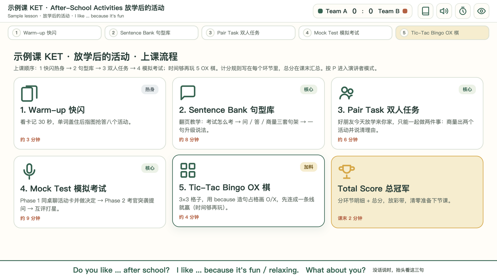

# kpf-speaking-deck

> 把一节 KET / PET / FCE 口语课，变成**一个双击就能上课的单文件 HTML**。
> 教师端讲、学生屏投影；讲义一页一件事，练习全是游戏，计分自动同步。



---

## 三条入口（按你是谁选）

### 我是老师，我想用它上课

1. 拿到这个目录后，**先打开 `welcome.html`**（双击就能开）——首次引导会带你走完；
2. 想直接感受：**`examples/` 里有两节打包好的样课**（KET / PET 各一节），双击对应的启动脚本（.command）即可上课；
3. 已有别人给你的课件（单个 .html + .command）：把两个文件放同一文件夹，双击 .command。

上课只需要 **macOS + 系统自带的 python3**。当前版本仅适配 macOS。

### 我用 AI 生成课件（Kimi Code 等 agent）

```bash
# 装到 agent 的 skill 目录（Kimi Code 认这个路径；Claude Code 放 ~/.claude/skills/）
git clone https://github.com/dongruiyue/kpf-speaking-deck.git ~/.agents/skills/kpf-speaking-deck
```

装好后在 AI 对话里发这句话（或打开 `welcome.html` 用里面的「复制需求」生成你自己的）：

> 请使用 kpf-speaking-deck 做一节 KET 口语课，主题是放学后的活动，时长 30 分钟。
> 没有材料就用原创内容。先给我简短课堂安排，再生成课件并检查。

生成、素材整理、验收都由 agent 完成；你只需要验收课堂内容本身。

### 我维护 / 改造这个 skill

看 `SKILL.md`（目录、构建、自检、铁律）和 `references/`（规格、版式预算、素材抽取、坑台账、发布清单）。
本地三份正式课的课时数据在 `lessons/`（不进公开仓库，见版权红线）。

---

## 一节课上课时长这样

```
┌─ 教师端（演讲者模式）───────────────┐   ┌─ 学生屏（投影）──────────┐
│ 顶栏：Team A 2 : 1 Team B · 计时器  │   │ 只读 · 静音 · 自动铺满    │
│ 步骤条：总览 → Part 1 → Part 2 …    │   │ 跟着教师端走，自动缩放    │
│ 舞台：翻页讲义 / 练习游戏           │   │ 题目为大，句架挂在底部    │
│ 底部：句架条（练习时随时能看）      │   │ 不出现教师按钮            │
│ 控制台：教学提示 · 该说什么 · +1/-1 │   │                          │
└────────────────────────────────────┘   └──────────────────────────┘
              同一台机器、同一浏览器的两个窗口，状态实时同步
```

## 这套东西是怎么搭的

- `assets/shell.html` —— **外壳**：同步、计分、计时、翻页、缩放、演讲者模式，跨课不变的部分全在这里。
- `modules/` —— **12 个练习模块**，每个都遵守同一份契约（纯渲染 / 广播动作 / 快照三件套）。
- `lessons/<name>.js` —— 每节课只写变化的部分：环节、句架、讲义页、练习参数。
- `scripts/build.py` —— 外壳 + 课时 + 素材 → 单文件 HTML（模块全量注入，不用声明依赖）。

写一节课 = 填数据；改一处 bug = 所有课一起好。

## 验收（agent / 维护者用）

构建时自动做数据校验（缺字段、重复环节 id、未知模块、素材键对不上都会拦住）。
构建后跑数值验收：

```bash
python3 scripts/verify.py <name>          # 12 条判据（无 golden 时第 2/12 条自动跳过）
node scripts/validate-deck.mjs <name>     # px 级体检：溢出/白空、标题间距、分级修正阶梯
node scripts/validate-deck.mjs <name> --m3  # 同步风暴/静音（真 Safari）
```

退出码即结论：0 全过、1 有未过。判据清单见 `references/shell-boundary.md` §七。

## 依赖

| 角色 | 需要什么 |
|---|---|
| **教师上课**（双击打开成品课件） | **macOS + python3**（macOS 自带）。**当前仅适配 macOS**；Windows / Linux 未完成适配，不承诺可用。 |
| **生成课件**（agent 跑构建） | 上面那些 + **node**。 |
| **验收**（可选） | 再加 **Chrome**（headless 验收）；第 8/9 条（同步/静音）需要真 **Safari**。 |
| **抽素材**（可选） | PyMuPDF + Pillow（`crop_photos.py`）、python-pptx（`extract_pptx.py` 增强）。 |

## 文档

| 文件 | 内容 |
|---|---|
| `GUIDE.md` | **完整说明**：原理 / 机制 / 对比人工 / 待改进 / FAQ |
| `SKILL.md` | agent 入口：用法 / 自检清单 / 铁律 |
| `references/shell-boundary.md` | 外壳契约 + 12 条验收标准 |
| `references/layout-budget.md` | 版式预算：每条判据的出处与实测基线 |
| `references/content-extraction.md` | 从 PPT / PDF 抽素材的实做法 |
| `references/pitfalls.md` | 踩坑台账（每条铁律背后的真 bug） |
| `references/publishing.md` | 发布清单与**版权红线** |

## ⚠ 版权红线

本仓库只含「外壳 + 模块 + 工具链 + 文档 + 原创示例」这套**机制**。
你自己的课时数据（`lessons/`）、旧工具（`golden/`）、产物（`out/`）都在 `.gitignore` 里 ——
如果它们来自出版的课本/课件（如剑桥系列），**只供本机教学使用，不要公开分发**。

## License

MIT（见 `LICENSE`）
